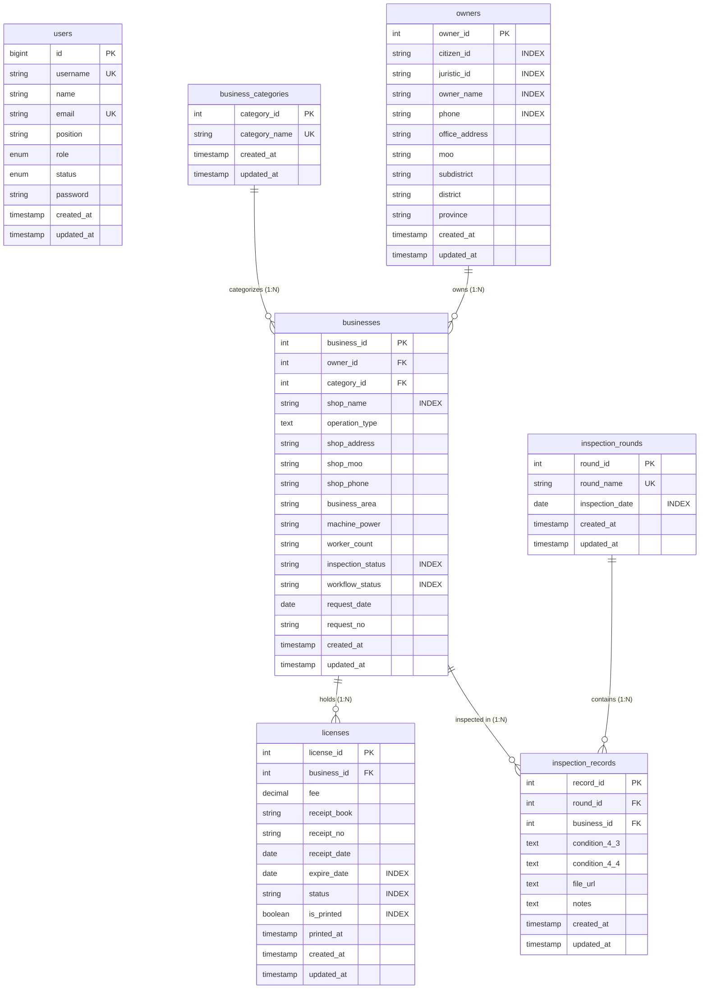
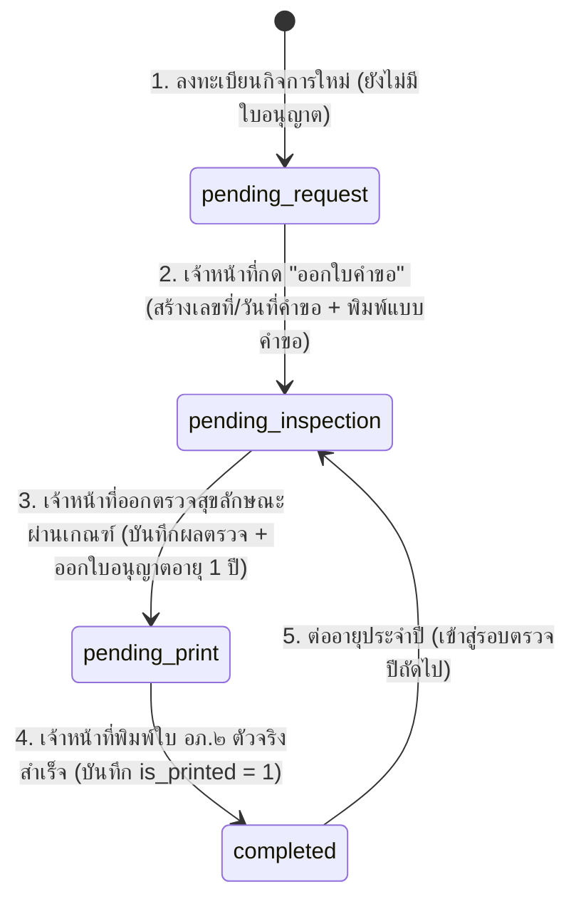
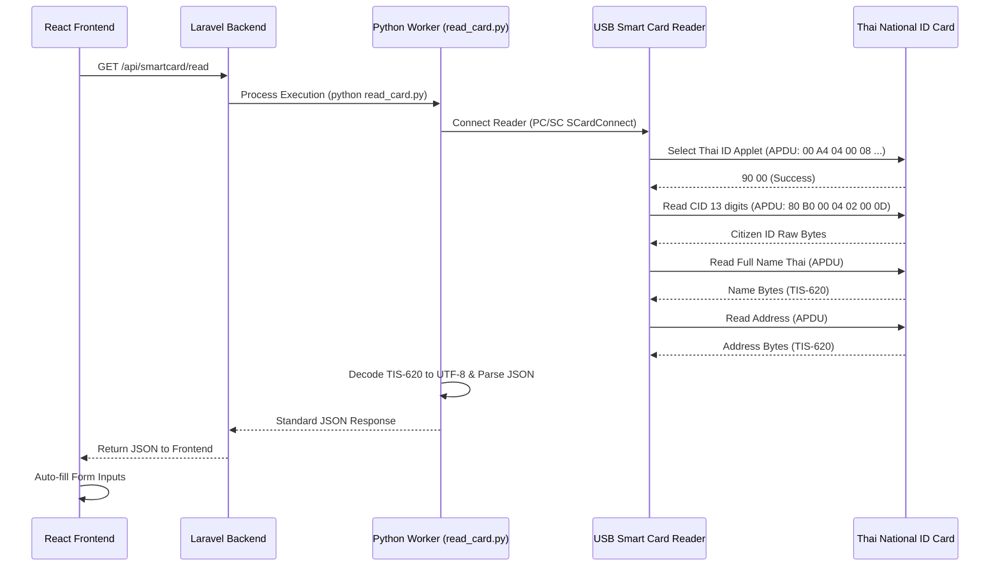
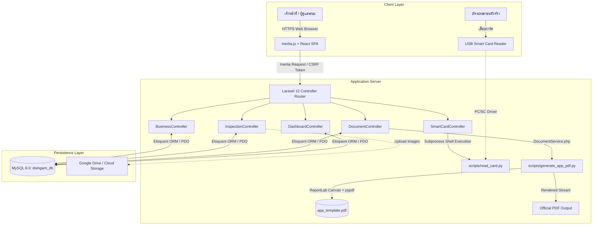

# ระบบสารสนเทศทะเบียนกิจการและใบอนุญาตออนไลน์ อบต.ดอยงาม (ESFD)
## (Electronic System for Doi Ngam SAO - Health Hazard Business Licensing System)

> **เอกสารข้อกำหนดทางเทคนิค สถาปัตยกรรมระบบ ฐานข้อมูล และคู่มือฟีเจอร์ฉบับสมบูรณ์**  
> **หน่วยงาน:** กองสาธารณสุขและสิ่งแวดล้อม องค์การบริหารส่วนตำบลดอยงาม อำเภอพาน จังหวัดเชียงราย  
> **เวอร์ชันระบบ:** 2.0.0 (Production-Ready Modern Stack)  
> **Repository:** `https://github.com/384-SupawitWongsupa/ESFD.git`

---

## สารบัญ (Table of Contents)
1. [บทนำและภาพรวมของระบบ (System Overview)](#1-บทนำและภาพรวมของระบบ-system-overview)
2. [เทคโนโลยีและเครื่องมือที่ใช้ในการพัฒนา (Technology Stack)](#2-เทคโนโลยีและเครื่องมือที่ใช้ในการพัฒนา-technology-stack)
3. [สถาปัตยกรรมฐานข้อมูลแบบละเอียด (Database Schema Specification)](#3-สถาปัตยกรรมฐานข้อมูลแบบละเอียด-database-schema-specification)
   - 3.1 แผนภาพความสัมพันธ์ฐานข้อมูล (ER Diagram)
   - 3.2 สรุปจำนวนตารางและจำนวนฟิลด์ทั้งหมด
   - 3.3 รายละเอียดตารางระบบงานหลัก (Core Business Tables - 6 ตาราง)
   - 3.4 รายละเอียดตารางความปลอดภัยและผู้ใช้งาน (Auth & System Tables - 3 ตาราง)
   - 3.5 รายละเอียดตารางสนับสนุนของ Framework (Framework Tables - 5 ตาราง)
4. [วงจรการทำงานของระบบ (4-Stage Workflow Lifecycle)](#4-วงจรการทำงานของระบบ-4-stage-workflow-lifecycle)
5. [รายละเอียดฟีเจอร์ทั้งหมดของระบบ (Complete Feature Breakdown)](#5-รายละเอียดฟีเจอร์ทั้งหมดของระบบ-complete-feature-breakdown)
6. [ระบบพิมพ์เอกสารราชการและเทคนิค PDF Overlay (Official Document Generation)](#6-ระบบพิมพ์เอกสารราชการและเทคนิค-pdf-overlay)
7. [ระบบอ่านบัตรประจำตัวประชาชน (Thai Smart Card Integration)](#7-ระบบอ่านบัตรประจำตัวประชาชน-thai-smart-card-integration)
8. [การไหลของข้อมูลภาพรวม (End-to-End Data Flow Architecture)](#8-การไหลของข้อมูลภาพรวม-end-to-end-data-flow-architecture)
9. [โครงสร้างโฟลเดอร์ซอร์สโค้ด (Directory Structure)](#9-โครงสร้างโฟลเดอร์ซอร์สโค้ด-directory-structure)
10. [ขั้นตอนการติดตั้งและตั้งค่าระบบ (Setup & Deployment Guide)](#10-ขั้นตอนการติดตั้งและตั้งค่าระบบ-setup--deployment-guide)
11. [โครงสร้างกิ่งงานของระบบ (Git Branching Strategy)](#11-โครงสร้างกิ่งงานของระบบ-git-branching-strategy)

---

## 1. บทนำและภาพรวมของระบบ (System Overview)

**ESFD (Electronic System for Doi Ngam SAO)** เป็นเว็บแอปพลิเคชันบริหารจัดการกระบวนการออกใบอนุญาตประกอบกิจการที่เป็นอันตรายต่อสุขภาพ ตามพระราชบัญญัติการสาธารณสุข พ.ศ. 2535 และข้อบัญญัติองค์การบริหารส่วนตำบลดอยงาม อำเภอพาน จังหวัดเชียงราย

ระบบถูกออกแบบมาเพื่อปฏิรูประบบการทำงานจากเดิมที่บันทึกข้อมูลซ้ำซ้อนในสมุดทะเบียนกระดาษและ Google Sheets สู่ระบบฐานข้อมูลเชิงสัมพันธ์ (Relational Database) ตามหลักการ **3rd Normal Form (3NF)** ป้องกันการซ้ำซ้อนของข้อมูล เชื่อมต่อกับอุปกรณ์เครื่องอ่านบัตรประจำตัวประชาชน (Smart Card Reader) ผ่านพอร์ต USB และสร้างเอกสารราชการ (แบบคำขอรับใบอนุญาต อบต.ดอยงาม และแบบ อภ.๒) ลงบนเทมเพลตมาตรฐานได้อย่างแม่นยำ พร้อมระบบติดตามวันหมดอายุของใบอนุญาตแบบ Real-time

---

## 2. เทคโนโลยีและเครื่องมือที่ใช้ในการพัฒนา (Technology Stack)

ระบบพัฒนาบนสถาปัตยกรรม **Modern Monolithic SPA** ที่ผสานพลังของ Laravel และ React เข้าด้วยกันอย่างไร้รอยต่อผ่าน Inertia.js โดยมีรายละเอียดเทคโนโลยีดังนี้:

| ส่วนประกอบ (Layer) | เทคโนโลยี / เครื่องมือ | เวอร์ชัน | บทบาทและหน้าที่ในระบบ |
| :--- | :--- | :---: | :--- |
| **Backend Framework** | **PHP** | 8.2+ | ภาษาหลักสำหรับประมวลผลทางฝั่งเซิร์ฟเวอร์ |
| | **Laravel Framework** | 12.0+ | MVC Framework ดูแล Routing, Eloquent ORM, Middleware, Database Migrations |
| **Frontend Framework** | **React** | 19.3.1 | ไลบรารีสร้าง User Interface แบบ Component-based ตอบสนองฉับไว |
| | **Inertia.js (React)** | 3.11.0 | สะพานเชื่อมระหว่าง Laravel และ React แบบไม่ต้องเขียน REST API แยกต่างหาก |
| **Styling & Design** | **Tailwind CSS** | 4.0.0 | Utility-first CSS Framework พร้อม `@tailwindcss/vite` จัดการธีมและ Responsive UI |
| | **Lucide React** | 1.72.0 | ชุดไอคอน UI คุณภาพสูง |
| | **Radix UI** | 2.4.1 | Headless Accessible UI Primitives (Select, Modal, Dialog) |
| **Data Visualization** | **Recharts** | 3.10.1 | ชาร์ตวิเคราะห์ข้อมูลสถิติ (Donut Chart, Bar Chart) บนหน้า Dashboard |
| **Notifications** | **Sonner** | 2.0.8 | Toast Notification แสดงผลสถานะสำเร็จ/แจ้งเตือนที่สวยงามและนุ่มนวล |
| **Spreadsheet** | **SheetJS (xlsx)** | 0.18.5 | สร้างและส่งออกไฟล์ Microsoft Excel (.xlsx) |
| **Database (RDBMS)** | **MySQL Server** | 8.0+ | ฐานข้อมูลเชิงสัมพันธ์หลัก รองรับภาษาไทยสมบูรณ์แบบ (`utf8mb4_unicode_ci`) |
| **Hardware Integration** | **Python** | 3.12+ | ตัวขับเคลื่อนงานเฉพาะทางฮาร์ดแวร์และการจัดการ PDF |
| | **pyscard** | 2.3+ | ไลบรารีเชื่อมต่อเครื่องอ่านบัตร PC/SC ส่งคำสั่ง APDU ดึงข้อมูลจากชิปบัตรประชาชนไทย (TIS-620) |
| **Document Generation** | **ReportLab** | 4.x | ไลบรารี Python วาดข้อความลงบน Canvas พิกัด Point ฝังฟอนต์ `THSarabunNew.ttf` |
| | **pypdf** | 4.x | ดำเนินการ Merge / Overlay ข้อความลงบนแบบฟอร์มเทมเพลตทางการ (`app_template.pdf`) |
| | **Dompdf (Laravel)** | 3.x | เอนจินเรนเดอร์เอกสาร PDF ฝั่ง PHP (`barryvdh/laravel-dompdf`) สำหรับ อภ.๒ |
| | **PHPWord** | 1.3+ | สร้างและแก้ไขเอกสาร Microsoft Word (.docx) สำหรับข้อกำหนดเงื่อนไข 4.3/4.4 |
| **Bundler & Tooling** | **Vite** | 7.0.7 | เครื่องมือ Build และ Hot-Module Replacement (HMR) ความเร็วสูง |
| | **Composer** | 2.x | PHP Dependency Manager |
| | **Git & GitHub** | ล่าสุด | ระบบควบคุมเวอร์ชันซอร์สโค้ด (Version Control System) |

---

## 3. สถาปัตยกรรมฐานข้อมูลแบบละเอียด (Database Schema Specification)

### 3.1 แผนภาพความสัมพันธ์ฐานข้อมูล (ER Diagram)



---

### 3.2 สรุปจำนวนตารางและจำนวนฟิลด์ทั้งหมด

ระบบมีโครงสร้างฐานข้อมูลรวมทั้งสิ้น **15 ตาราง** แบ่งออกเป็น 3 กลุ่มดังนี้:

| กลุ่มตาราง | รายชื่อตาราง | จำนวนฟิลด์ | บทบาทหน้าที่ |
| :--- | :--- | :---: | :--- |
| **1. ตารางหลักของระบบงาน (Core Business)** | `business_categories` | 4 | หมวดหมู่ประเภทกิจการหลัก |
| | `owners` | 12 | ข้อมูลเจ้าของ / ผู้ประกอบการ / นิติบุคคล |
| | `businesses` | 17 | ข้อมูลสถานประกอบการ / ร้านค้า / ที่ตั้ง |
| | `licenses` | 12 | ประวัติใบอนุญาต การชำระเงิน และวันหมดอายุ |
| | `inspection_rounds` | 5 | รอบวาระการออกตรวจประเมินสุขลักษณะ |
| | `inspection_records` | 9 | บันทึกผลการตรวจรายสถานประกอบการ |
| **2. ตารางผู้ใช้และความปลอดภัย (Auth & Users)** | `users` | 12 | บัญชีผู้ใช้งานระบบ ระดับสิทธิ์ และสถานะ |
| | `password_reset_tokens` | 3 | โทเค็นสำหรับการรีเซ็ตรหัสผ่าน |
| | `sessions` | 6 | ข้อมูล Active Session ของผู้ใช้ในระบบ |
| | `login_logs` | 11 | บันทึกประวัติการเข้าสู่ระบบ หมายเลข IP และอุปกรณ์ |
| **3. ตารางสนับสนุนของ Framework** | `cache` | 3 | ระบบแคชของ Laravel |
| | `cache_locks` | 3 | ป้องกัน Race Condition ในแคช |
| | `jobs` | 7 | งานประมวลผลพื้นหลัง (Queue Jobs) |
| | `job_batches` | 10 | กลุ่มงานคิวแบบกลุ่ม |
| | `failed_jobs` | 7 | บันทึกข้อผิดพลาดของงานคิวที่ล้มเหลว |
| **รวมทั้งสิ้น** | **15 ตาราง** | **121 ฟิลด์** | **(Core Business: 6 ตาราง 59 ฟิลด์ / Auth: 4 ตาราง 32 ฟิลด์ / Framework: 5 ตาราง 30 ฟิลด์)** |

---

### 3.3 รายละเอียดตารางระบบงานหลัก (Core Business Tables)

#### ตารางที่ 1: `business_categories` (หมวดหมู่ประเภทกิจการหลัก)
*ตารางกำหนดกลุ่มประเภทกิจการตามระเบียบข้อบัญญัติท้องถิ่น*
- **Primary Key:** `category_id`
- **จำนวนฟิลด์:** 4 ฟิลด์

| ลำดับ | ชื่อฟิลด์ (Field Name) | ประเภทข้อมูล (Type) | Nullable | คีย์ / คุณลักษณะ | คำอธิบายการใช้งาน |
| :---: | :--- | :--- | :---: | :---: | :--- |
| 1 | `category_id` | `INT UNSIGNED` | NO | **PK**, AUTO_INCREMENT | รหัสประเภทกิจการ |
| 2 | `category_name` | `VARCHAR(100)` | NO | **UNIQUE** | ชื่อหมวดหมู่ เช่น "สถานประกอบกิจการ", "จำหน่าย/สะสมอาหาร", "ตลาด" |
| 3 | `created_at` | `TIMESTAMP` | YES | - | วันเวลาที่สร้างข้อมูล |
| 4 | `updated_at` | `TIMESTAMP` | YES | - | วันเวลาที่แก้ไขข้อมูลล่าสุด |

---

#### ตารางที่ 2: `owners` (ข้อมูลเจ้าของ / ผู้ประกอบการ / นิติบุคคล)
*แยกข้อมูลบุคคล/นิติบุคคลออกจากสถานประกอบการ (ผู้ประกอบการ 1 คนสามารถเป็นเจ้าของได้หลายสถานประกอบการ 1:N)*
- **Primary Key:** `owner_id`
- **จำนวนฟิลด์:** 12 ฟิลด์

| ลำดับ | ชื่อฟิลด์ (Field Name) | ประเภทข้อมูล (Type) | Nullable | คีย์ / คุณลักษณะ | คำอธิบายการใช้งาน |
| :---: | :--- | :--- | :---: | :---: | :--- |
| 1 | `owner_id` | `INT UNSIGNED` | NO | **PK**, AUTO_INCREMENT | รหัสประจำตัวผู้ประกอบการ |
| 2 | `citizen_id` | `VARCHAR(20)` | YES | **INDEX** | เลขประจำตัวประชาชน 13 หลัก (กรณีบุคคลธรรมดา) |
| 3 | `juristic_id` | `VARCHAR(50)` | YES | **INDEX** | เลขทะเบียนนิติบุคคล (กรณีบริษัท/ห้างหุ้นส่วน) |
| 4 | `owner_name` | `VARCHAR(255)` | NO | **INDEX** | คำนำหน้า ชื่อ และนามสกุล หรือชื่อนิติบุคคล |
| 5 | `phone` | `VARCHAR(50)` | YES | **INDEX** | หมายเลขโทรศัพท์หลักของผู้ประกอบการ |
| 6 | `office_address` | `VARCHAR(255)` | YES | - | ที่อยู่สำนักงาน หรือที่อยู่ตามบัตรประชาชน (บ้านเลขที่) |
| 7 | `moo` | `VARCHAR(10)` | YES | - | หมู่ที่ ตามที่อยู่ผู้ประกอบการ |
| 8 | `subdistrict` | `VARCHAR(100)` | NO | DEFAULT `'ดอยงาม'` | ตำบล |
| 9 | `district` | `VARCHAR(100)` | NO | DEFAULT `'พาน'` | อำเภอ |
| 10 | `province` | `VARCHAR(100)` | NO | DEFAULT `'เชียงราย'` | จังหวัด |
| 11 | `created_at` | `TIMESTAMP` | YES | - | วันเวลาที่ลงทะเบียนผู้ประกอบการ |
| 12 | `updated_at` | `TIMESTAMP` | YES | - | วันเวลาที่มีการปรับปรุงข้อมูลล่าสุด |

---

#### ตารางที่ 3: `businesses` (ข้อมูลสถานประกอบการ / ร้านค้า)
*เก็บรายละเอียดลักษณะการดำเนินกิจการ ขนาดทางกายภาพ และสถานะ Workflow ตลอดวงจร*
- **Primary Key:** `business_id`
- **Foreign Keys:** `owner_id` -> `owners.owner_id`, `category_id` -> `business_categories.category_id`
- **จำนวนฟิลด์:** 17 ฟิลด์

| ลำดับ | ชื่อฟิลด์ (Field Name) | ประเภทข้อมูล (Type) | Nullable | คีย์ / คุณลักษณะ | คำอธิบายการใช้งาน |
| :---: | :--- | :--- | :---: | :---: | :--- |
| 1 | `business_id` | `INT UNSIGNED` | NO | **PK**, AUTO_INCREMENT | รหัสสถานประกอบการ |
| 2 | `owner_id` | `INT UNSIGNED` | NO | **FK** (Cascade Delete) | รหัสผู้ประกอบการเจ้าของกิจการ |
| 3 | `category_id` | `INT UNSIGNED` | NO | **FK** (Restrict Delete) | รหัสหมวดหมู่ประเภทกิจการ |
| 4 | `shop_name` | `VARCHAR(255)` | YES | **INDEX** | ชื่อทางการค้า / ชื่อสถานประกอบการ / ชื่อร้าน |
| 5 | `operation_type` | `TEXT` | NO | - | รายละเอียดประเภทการประกอบกิจการ (เช่น ซ่อมจักรยานยนต์, ร้านขายของชำ) |
| 6 | `shop_address` | `VARCHAR(255)` | YES | - | ที่ตั้งสถานประกอบการ (เลขที่) |
| 7 | `shop_moo` | `VARCHAR(10)` | YES | - | ที่ตั้งสถานประกอบการ (หมู่ที่) |
| 8 | `shop_phone` | `VARCHAR(50)` | YES | - | หมายเลขโทรศัพท์ของสถานประกอบการ |
| 9 | `business_area` | `VARCHAR(100)` | YES | - | ขนาดพื้นที่ประกอบกิจการ (ตารางเมตร) |
| 10 | `machine_power` | `VARCHAR(100)` | YES | - | กำลังเครื่องจักรรวม (แรงม้า / กิโลวัตต์) |
| 11 | `worker_count` | `VARCHAR(50)` | YES | - | จำนวนคนงาน / ผู้ปฏิบัติงานในร้าน |
| 12 | `inspection_status` | `VARCHAR(30)` | NO | DEFAULT `'pending'`, **INDEX** | สถานะการออกตรวจ (`'pending'` = รอตรวจ, `'inspected'` = ออกตรวจแล้ว) |
| 13 | `workflow_status` | `VARCHAR(30)` | NO | DEFAULT `'pending_request'`, **INDEX** | สถานะขั้นตอนของกิจการ: `pending_request`, `pending_inspection`, `pending_print`, `completed` |
| 14 | `request_date` | `DATE` | YES | - | วันที่ยื่นคำขอรับใบอนุญาต |
| 15 | `request_no` | `VARCHAR(50)` | YES | - | เลขที่คำขอรับใบอนุญาต (เช่น ๑/๒๕๖๙) |
| 16 | `created_at` | `TIMESTAMP` | YES | - | วันเวลาที่สร้างข้อมูล |
| 17 | `updated_at` | `TIMESTAMP` | YES | - | วันเวลาที่ปรับปรุงข้อมูล |

---

#### ตารางที่ 4: `licenses` (ข้อมูลใบอนุญาตและการเงิน)
*บันทึกข้อมูลใบอนุญาต ประวัติการชำระเงินค่าธรรมเนียม และสถานะการพิมพ์ใบ อภ.๒*
- **Primary Key:** `license_id`
- **Foreign Key:** `business_id` -> `businesses.business_id`
- **จำนวนฟิลด์:** 12 ฟิลด์

| ลำดับ | ชื่อฟิลด์ (Field Name) | ประเภทข้อมูล (Type) | Nullable | คีย์ / คุณลักษณะ | คำอธิบายการใช้งาน |
| :---: | :--- | :--- | :---: | :---: | :--- |
| 1 | `license_id` | `INT UNSIGNED` | NO | **PK**, AUTO_INCREMENT | รหัสใบอนุญาต |
| 2 | `business_id` | `INT UNSIGNED` | NO | **FK** (Cascade Delete) | รหัสสถานประกอบการ |
| 3 | `fee` | `DECIMAL(10,2)` | NO | DEFAULT `0.00` | อัตราค่าธรรมเนียมใบอนุญาต (บาท) |
| 4 | `receipt_book` | `VARCHAR(50)` | YES | - | เล่มที่ใบเสร็จรับเงิน |
| 5 | `receipt_no` | `VARCHAR(50)` | YES | - | เลขที่ใบเสร็จรับเงิน |
| 6 | `receipt_date` | `DATE` | YES | - | วันที่ออกใบเสร็จรับเงิน |
| 7 | `expire_date` | `DATE` | YES | **INDEX** | วันหมดอายุของใบอนุญาต (1 ปีนับจากวันตรวจ/ออกใบ) |
| 8 | `status` | `VARCHAR(20)` | NO | DEFAULT `'active'`, **INDEX** | สถานะใบอนุญาต: `'active'` (ใช้งาน), `'expired'` (หมดอายุ), `'renewed'` (ต่ออายุแล้ว) |
| 9 | `is_printed` | `BOOLEAN` | NO | DEFAULT `0`, **INDEX** | สถานะการพิมพ์ใบ อภ.๒ (`1` = พิมพ์แล้ว, `0` = ยังไม่พิมพ์) |
| 10 | `printed_at` | `TIMESTAMP` | YES | - | วันเวลาที่สั่งพิมพ์ใบอนุญาต อภ.๒ สำเร็จ |
| 11 | `created_at` | `TIMESTAMP` | YES | - | วันเวลาที่ออกใบอนุญาต |
| 12 | `updated_at` | `TIMESTAMP` | YES | - | วันเวลาที่มีการแก้ไขข้อมูล |

---

#### ตารางที่ 5: `inspection_rounds` (รอบการออกตรวจสุขลักษณะ)
*บันทึกวาระและรอบช่วงเวลาการลงพื้นที่ตรวจสถานประกอบการของเจ้าหน้าที่*
- **Primary Key:** `round_id`
- **จำนวนฟิลด์:** 5 ฟิลด์

| ลำดับ | ชื่อฟิลด์ (Field Name) | ประเภทข้อมูล (Type) | Nullable | คีย์ / คุณลักษณะ | คำอธิบายการใช้งาน |
| :---: | :--- | :--- | :---: | :---: | :--- |
| 1 | `round_id` | `INT UNSIGNED` | NO | **PK**, AUTO_INCREMENT | รหัสรอบการตรวจ |
| 2 | `round_name` | `VARCHAR(100)` | NO | **UNIQUE** | ชื่อรอบการออกตรวจ เช่น "รอบที่ 1/2569", "ออกตรวจประจำเดือน พ.ย. 68" |
| 3 | `inspection_date` | `DATE` | NO | **INDEX** | วันที่กำหนดจัดกิจกรรมออกตรวจ |
| 4 | `created_at` | `TIMESTAMP` | YES | - | วันเวลาที่สร้างรอบการตรวจ |
| 5 | `updated_at` | `TIMESTAMP` | YES | - | วันเวลาที่แก้ไขข้อมูลรอบตรวจ |

---

#### ตารางที่ 6: `inspection_records` (บันทึกผลการออกตรวจรายสถานประกอบการ)
*Bridge Table เชื่อมโยงรอบตรวจและสถานประกอบการ จัดเก็บเงื่อนไขท้ายใบอนุญาต และลิงก์รูปภาพ*
- **Primary Key:** `record_id`
- **Foreign Keys:** `round_id` -> `inspection_rounds.round_id`, `business_id` -> `businesses.business_id`
- **Unique Constraint:** `(round_id, business_id)` ป้องกันการลงผลตรวจซ้ำในรอบเดียวกัน
- **จำนวนฟิลด์:** 9 ฟิลด์

| ลำดับ | ชื่อฟิลด์ (Field Name) | ประเภทข้อมูล (Type) | Nullable | คีย์ / คุณลักษณะ | คำอธิบายการใช้งาน |
| :---: | :--- | :--- | :---: | :---: | :--- |
| 1 | `record_id` | `INT UNSIGNED` | NO | **PK**, AUTO_INCREMENT | รหัสบันทึกผลการตรวจ |
| 2 | `round_id` | `INT UNSIGNED` | NO | **FK** (Cascade Delete) | รหัสรอบการตรวจที่เกี่ยวข้อง |
| 3 | `business_id` | `INT UNSIGNED` | NO | **FK** (Cascade Delete) | รหัสสถานประกอบการที่ได้รับการตรวจ |
| 4 | `condition_4_3` | `TEXT` | YES | - | เงื่อนไขเพิ่มเติมข้อ 4.3 ตามที่เจ้าหน้าที่สาธารณสุขกำหนด |
| 5 | `condition_4_4` | `TEXT` | YES | - | เงื่อนไขเพิ่มเติมข้อ 4.4 ตามที่เจ้าหน้าที่สาธารณสุขกำหนด |
| 6 | `file_url` | `TEXT` | YES | - | ลิงก์ URL ไฟล์รูปถ่ายหน้างาน หรือเอกสารสแกนบน Cloud/Google Drive |
| 7 | `notes` | `TEXT` | YES | - | หมายเหตุผลการตรวจ และรายชื่อเจ้าหน้าที่ผู้ร่วมตรวจ |
| 8 | `created_at` | `TIMESTAMP` | YES | - | วันเวลาที่บันทึกผลตรวจ |
| 9 | `updated_at` | `TIMESTAMP` | YES | - | วันเวลาที่แก้ไขผลตรวจ |

---

### 3.4 รายละเอียดตารางความปลอดภัยและผู้ใช้งาน (Auth & System Tables)

#### ตารางที่ 7: `users` (ข้อมูลผู้ใช้งานและระดับสิทธิ์)
*จัดเก็บข้อมูลบัญชีผู้ใช้งาน สิทธิ์การเข้าถึง และสถานะการอนุมัติการใช้งาน*
- **Primary Key:** `id`
- **จำนวนฟิลด์:** 12 ฟิลด์

| ลำดับ | ชื่อฟิลด์ (Field Name) | ประเภทข้อมูล (Type) | Nullable | คีย์ / คุณลักษณะ | คำอธิบายการใช้งาน |
| :---: | :--- | :--- | :---: | :---: | :--- |
| 1 | `id` | `BIGINT UNSIGNED` | NO | **PK**, AUTO_INCREMENT | รหัสผู้ใช้งาน |
| 2 | `username` | `VARCHAR(255)` | NO | **UNIQUE** | ชื่อผู้ใช้สำหรับลงชื่อเข้าใช้ระบบ (Login) |
| 3 | `name` | `VARCHAR(255)` | NO | - | ชื่อ - นามสกุลจริงของเจ้าหน้าที่ |
| 4 | `email` | `VARCHAR(255)` | YES | **UNIQUE** | อีเมลของเจ้าหน้าที่ (ไม่บังคับ) |
| 5 | `position` | `VARCHAR(255)` | YES | - | ตำแหน่งงาน เช่น "นักวิชาการสาธารณสุขปฏิบัติการ" |
| 6 | `role` | `ENUM('admin', 'staff')` | NO | DEFAULT `'staff'` | ระดับสิทธิ์: `admin` (ผู้ดูแลระบบ), `staff` (เจ้าหน้าที่) |
| 7 | `status` | `ENUM('approved', 'pending', 'revoked')` | NO | DEFAULT `'pending'` | สถานะ: `approved` (ใช้งานได้), `pending` (รออนุมัติ), `revoked` (ระงับสิทธิ์) |
| 8 | `email_verified_at` | `TIMESTAMP` | YES | - | วันเวลายืนยันอีเมล |
| 9 | `password` | `VARCHAR(255)` | NO | - | รหัสผ่านที่ผ่านการแฮชด้วย Bcrypt |
| 10 | `remember_token` | `VARCHAR(100)` | YES | - | โทเค็นสำหรับการจดจำการเข้าสู่ระบบ (Remember Me) |
| 11 | `created_at` | `TIMESTAMP` | YES | - | วันเวลาที่ลงทะเบียนผู้ใช้ |
| 12 | `updated_at` | `TIMESTAMP` | YES | - | วันเวลาที่แก้ไขข้อมูลผู้ใช้ |

---

#### ตารางที่ 8: `password_reset_tokens` (โทเค็นรีเซ็ตรหัสผ่าน)
- **Primary Key:** `email`
- **จำนวนฟิลด์:** 3 ฟิลด์ (`email`, `token`, `created_at`)

#### ตารางที่ 9: `sessions` (Active HTTP Sessions)
- **Primary Key:** `id`
- **จำนวนฟิลด์:** 6 ฟิลด์ (`id`, `user_id`, `ip_address`, `user_agent`, `payload`, `last_activity`)

---

#### ตารางที่ 10: `login_logs` (บันทึกประวัติการเข้าสู่ระบบและความปลอดภัย)
*เก็บบันทึกประวัติการลงชื่อเข้าใช้งานของผู้ใช้ทุกคน ทั้งที่สำเร็จและล้มเหลว เพื่อการตรวจสอบ (Audit Trail)*
- **Primary Key:** `id`
- **Foreign Key:** `user_id` -> `users.id` (onDelete Set Null)
- **จำนวนฟิลด์:** 11 ฟิลด์

| ลำดับ | ชื่อฟิลด์ (Field Name) | ประเภทข้อมูล (Type) | Nullable | คีย์ / คุณลักษณะ | คำอธิบายการใช้งาน |
| :---: | :--- | :--- | :---: | :---: | :--- |
| 1 | `id` | `BIGINT UNSIGNED` | NO | **PK**, AUTO_INCREMENT | รหัสบันทึกประวัติการเข้าใช้งาน |
| 2 | `user_id` | `BIGINT UNSIGNED` | YES | **FK**, **INDEX** | รหัสผู้ใช้งานที่เข้าสู่ระบบ (Null หากไม่พบบัญชี) |
| 3 | `username` | `VARCHAR(100)` | NO | **INDEX** | ชื่อผู้ใช้งานที่ใช้เข้าสู่ระบบ |
| 4 | `name` | `VARCHAR(255)` | YES | - | ชื่อ-นามสกุลจริงของเจ้าหน้าที่ ณ ขณะเข้าใช้งาน |
| 5 | `role` | `VARCHAR(50)` | YES | **INDEX** | ระดับสิทธิ์ของบัญชี (`admin` / `staff`) |
| 6 | `ip_address` | `VARCHAR(45)` | YES | - | หมายเลข IP Address ของเครื่องที่เข้าใช้งาน (IPv4/IPv6) |
| 7 | `user_agent` | `TEXT` | YES | - | ข้อมูลเบราว์เซอร์และระบบปฏิบัติการของอุปกรณ์ |
| 8 | `status` | `ENUM('success', 'failed')` | NO | DEFAULT `'success'`, **INDEX** | สถานะการเข้าสู่ระบบ: `success` (สำเร็จ), `failed` (ล้มเหลว) |
| 9 | `failure_reason` | `VARCHAR(255)` | YES | - | สาเหตุความล้มเหลว (เช่น รหัสผ่านผิด, บัญชีรอการอนุมัติ) |
| 10 | `login_at` | `TIMESTAMP` | YES | **INDEX** | วันเวลาที่ลงชื่อเข้าสู่ระบบ |
| 11 | `created_at` / `updated_at` | `TIMESTAMP` | YES | - | วันเวลาที่บันทึกข้อมูล |

---

### 3.5 รายละเอียดตารางสนับสนุนของ Framework (5 ตาราง)
- `cache` (3 ฟิลด์), `cache_locks` (3 ฟิลด์): ระบบแคชประสิทธิภาพสูง
- `jobs` (7 ฟิลด์), `job_batches` (10 ฟิลด์), `failed_jobs` (7 ฟิลด์): ระบบประมวลผลงานแบบ異步 (Asynchronous Background Queue)

---

## 4. วงจรการทำงานของระบบ (4-Stage Workflow Lifecycle)

ระบบ ESFD ควบคุมวงจรชีวิตของสถานประกอบการด้วย **4-Stage Finite State Machine** อย่างเคร่งครัด เพื่อป้องกันการลัดขั้นตอนทางระเบียบราชการ:



### รายละเอียดแต่ละขั้นตอน:
1. **`pending_request` (รอยื่นคำขอ):** สถานะเมื่อลงทะเบียนกิจการใหม่ ข้อมูลผู้ประกอบการและที่ตั้งร้านค้าจะถูกบันทึกเข้าระบบ แต่ยังไม่มีประวัติใบอนุญาตและการเงิน
2. **`pending_inspection` (รอออกตรวจ):** เกิดขึ้นเมื่อเจ้าหน้าที่กดปุ่ม **"กดออกใบคำขอ"** ในหน้าแสดงข้อมูลร้าน ระบบจะสร้าง `request_no` และ `request_date` อัตโนมัติ พร้อมส่งผู้ใช้ไปยังหน้าพรีวิวเพื่อพิมพ์ **"แบบคำขอรับใบอนุญาต อบต.ดอยงาม"**
3. **`pending_print` (รอพิมพ์ใบอนุญาต):** เมื่อทีมเจ้าหน้าที่ลงพื้นที่ตรวจประเมินสุขลักษณะและบันทึกผลตรวจผ่านระบบ พร้อมระบุเลขที่ใบเสร็จ ค่าธรรมเนียม ระบบจะสร้างเรคคอร์ดในตาราง `licenses` มีอายุ 1 ปี และย้ายสถานะเป็นรอพิมพ์ใบ อภ.๒
4. **`completed` (เสร็จสมบูรณ์):** เจ้าหน้าที่สั่งพิมพ์ใบ อภ.๒ ทางการ ระบบจะอัปเดต `is_printed = true`, บันทึกเวลา `printed_at` และเปลี่ยนสถานะเป็น Completed พร้อมแสดงสถานะสมบูรณ์ในหน้าทะเบียน

---

## 5. รายละเอียดฟีเจอร์ทั้งหมดของระบบ (Complete Feature Breakdown)

### 5.1 ระบบยืนยันตัวตนและการจัดการสิทธิ์ (Authentication & RBAC)
- **หน้า Login แบบราชการ:** ดีไซน์เรียบหรู ฟอนต์ Noto Sans Thai และสารบรรณ พร้อมระบบตรวจสอบชื่อผู้ใช้และรหัสผ่าน
- **Role-Based Access Control (RBAC):**
  - `admin` (ผู้ดูแลระบบ): สามารถเข้าถึงเมนูผู้ดูแลระบบ จัดการผู้ใช้ อนุมัติสิทธิ์ รีเซ็ตรหัสผ่าน และลบข้อมูลได้
  - `staff` (เจ้าหน้าที่สาธารณสุข): เข้าถึงระบบทะเบียน ค้นหา บันทึกผลตรวจ และพิมพ์เอกสาร
- **ระบบสถานะบัญชี (Account Approval Workflow):** บัญชีที่ลงทะเบียนใหม่จะอยู่ในสถานะ `pending` จนกว่าแอดมินจะกดยืนยันอนุมัติ (`approved`) จึงจะสามารถเข้าสู่ระบบได้

### 5.2 ระบบจัดการผู้ใช้งานสำหรับแอดมิน (Admin User Management)
- **Path:** `/admin/users`
- **Dashboard สรุปจำนวนผู้ใช้:** แสดงการแบ่งหมวดหมู่ผู้ใช้ (อนุมัติแล้ว, รออนุมัติ, ระงับสิทธิ์)
- **ฟังก์ชันการอนุมัติ/ระงับ:** ปุ่ม Approve/Revoke บัญชีแบบคลิกเดียว
- **ระบบ Reset Password:** แอดมินสามารถกำหนดรหัสผ่านใหม่ให้กับเจ้าหน้าที่ได้ทันที

### 5.3 ระบบบันทึกประวัติการเข้าสู่ระบบ (Login Audit Trail & Security Logs)
- **Path:** `/admin/logs`
- **บันทึกทุกเหตุการณ์การเข้าระบบ (Login Logging):** เก็บบันทึกข้อมูลทั้งกรณีเข้าสู่ระบบสำเร็จ (Success) และกรณีล้มเหลว (Failed) พร้อมระบุสาเหตุ เช่น รหัสผ่านไม่ถูกต้อง, ไม่พบบัญชี, บัญชีรอการอนุมัติ หรือบัญชีถูกระงับสิทธิ์
- **บันทึก Metadata ครบถ้วน:** วันที่-เวลา (พ.ศ.), Username, ชื่อเจ้าหน้าที่, สิทธิ์การใช้งาน, หมายเลข IP Address และ User-Agent
- **ตรวจจับอุปกรณ์อัตโนมัติ (Device & Browser Detection):** วิเคราะห์ประเภทอุปกรณ์ (Desktop / Mobile) ระบบปฏิบัติการ (Windows, macOS, Linux, iOS, Android) และเบราว์เซอร์ (Chrome, Edge, Safari, Firefox)
- **ระบบค้นหาและตัวกรอง 4 มิติ:** ค้นหาตามชื่อผู้ใช้/IP, กรองตามสถานะสำเร็จ/ล้มเหลว, กรองตามสิทธิ์ Admin/Staff และกรองตามวันที่
- **สรุปสถิติความปลอดภัย 4 ด้าน (Stat Cards):** จำนวนการเข้าระบบทั้งหมด, สำเร็จ, ล้มเหลว, และจำนวนครั้งในวันปัจจุบัน

### 5.4 ระบบเชื่อมต่อเครื่องอ่านบัตรประชาชน (Smart Card Reader)
- **อ่านบัตรประชาชนจริงผ่าน USB:** เสียบบัตรประชาชนไทยเข้ากับเครื่องอ่านแบบ PC/SC (เช่น ACR39U, Taisys) ระบบจะสื่อสารผ่าน APDU คำสั่งตรงไปยังชิปการ์ด
- **ดึงข้อมูลอัตโนมัติครบถ้วน:**
  - เลขประจำตัวประชาชน 13 หลัก
  - ชื่อ - นามสกุล (ภาษาไทย) แยกคำนำหน้า
  - วันเกิด และอายุ
  - ที่อยู่ตามทะเบียนบ้าน (บ้านเลขที่, หมู่ที่, ตำบล, อำเภอ, จังหวัด)
- **Smart Card Mock Data:** ระบบมีระบบจำลองข้อมูลบัตร (Mock) สำหรับทดสอบระบบในเครื่องที่ไม่ได้เสียบตัวอ่านบัตร

### 5.4 ระบบสืบค้นอัจฉริยะและทำเนียบผู้ประกอบการ (Smart Search & Directory)
- **Path:** `/search`
- **Multi-criteria Filtering:** ค้นหาพร้อมกันได้จาก:
  - คำค้นหา (Search Query): ชื่อร้าน, ชื่อเจ้าของ, เลขบัตร 13 หลัก, เลขนิติบุคคล, เบอร์โทร
  - หมู่ที่ (Moo Filter): เลือกกรองเฉพาะหมู่บ้าน 1-18 ตำบลดอยงาม
  - หมวดหมู่ (Category Filter): สถานประกอบการ, จำหน่าย/สะสมอาหาร, ตลาด
  - สถานะการตรวจ (Inspection Status): ทั้งหมด, รอตรวจ, ตรวจแล้ว
- **One-Click Smart Card Search:** กดปุ่ม "อ่านบัตรค้นหา" เสียบบัตรประชาชนของผู้มาติดต่อ ระบบจะดึงเลข 13 หลักมาค้นหากิจการทั้งหมดที่เป็นของบุคคลนั้นทันที

### 5.5 ระบบลงทะเบียนสถานประกอบการใหม่ (Business Registration)
- **Path:** `/businesses/create`
- **Smart Card Auto-Fill:** เสียบบัตรประชาชนแล้วกดปุ่มเดียว ข้อมูลชื่อ-นามสกุล ที่อยู่ จะถูกกรอกลงในฟอร์มอัตโนมัติ
- **Local Storage Auto-Save Draft:** มีระบบบันทึกแบบร่างลง Local Storage ของเบราว์เซอร์อัตโนมัติ ป้องกันข้อมูลสูญหายกรณีเน็ตหลุดหรือปิดหน้าต่างกะทันหัน
- **ตรวจสอบการมีอยู่ของผู้ประกอบการ:** หากเป็นเจ้าของเดิม ระบบจะผูกกิจการใหม่เข้ากับ `owner_id` เดิมทันทีโดยไม่สร้างบุคคลซ้ำ

### 5.6 ระบบบันทึกผลการออกตรวจสุขลักษณะ (Inspection Workflow)
- **Path:** `/inspections`
- **ระบบสร้างรอบการตรวจ (Inspection Rounds):** สามารถเพิ่มรอบการตรวจประจำปีหรือประจำเดือน เช่น "รอบที่ 1/2569"
- **Inspection Record Modal:** โมดอลบันทึกผลตรวจหน้างาน:
  - เลือกรอบการตรวจ
  - บันทึกเงื่อนไขเพิ่มเติมข้อ 4.3 และ 4.4
  - บันทึกข้อมูลใบเสร็จรับเงิน (เล่มที่, เลขที่, วันที่, จำนวนเงิน)
  - แนบลิงก์ไฟล์รูปภาพการตรวจหน้างาน (Google Drive / Cloud)
  - คำนวณวันหมดอายุใบอนุญาตอัตโนมัติ (1 ปีนับจากวันตรวจ)

### 5.7 ระบบติดตามใบอนุญาตและแจ้งเตือนวันหมดอายุ (Expiration Tracking)
- **Path:** `/expirations`
- **ระบบแบ่งแท็บ 3 ระดับความเร่งด่วน:**
  - 🛑 **หมดอายุแล้ว (Expired):** ใบอนุญาตที่หมดอายุแล้ว ต้องเร่งรัดติดตาม
  - ⏳ **ใกล้หมดอายุ (Expiring):** ใบอนุญาตที่จะหมดอายุภายใน 90 วัน
  - 🟢 **ยังไม่หมดอายุ (Active):** ใบอนุญาตที่ยังคงมีอายุเกิน 90 วันขึ้นไป
- **Export รายงาน Excel (.xlsx):** ส่งออกรายชื่อผู้ประกอบการที่ใบอนุญาตหมดอายุหรือใกล้หมดอายุ พร้อมเบอร์โทรและที่อยู่ เพื่อใช้ออกหนังสือเตือน

### 5.8 ระบบจัดการคิวรอพิมพ์ใบอนุญาต (Pending Print Queue)
- **Path:** `/pending-print`
- รวมรายการสถานประกอบการที่ผ่านการตรวจสุขลักษณะแล้วและมีใบอนุญาต แต่ยังไม่ได้พิมพ์ใบ อภ.๒ ตัวจริง เพื่อให้เจ้าหน้าที่ฝ่ายเอกสารสามารถกดพิมพ์ต่อเนื่องได้สะดวกรวดเร็ว

### 5.9 แดชบอร์ดสรุปผลและสถิติสารสนเทศผู้บริหาร (Dashboard & MIS Analytics)
- **Path:** `/` หรือ `/dashboard`
- **Metric Summary Cards:** กิจการทั้งหมด, ใบอนุญาตที่ใช้งานได้, กิจการที่ใกล้หมดอายุ, กิจการที่หมดอายุแล้ว
- **Interactive Recharts:**
  - Donut Chart แสดงสัดส่วนสถานะใบอนุญาต
  - Bar Chart แสดงจำนวนกิจการแยกตามหมู่บ้าน (หมู่ 1 - หมู่ 18)
  - Bar Chart แสดงจำนวนกิจการแยกตามหมวดหมู่

---

## 6. ระบบพิมพ์เอกสารราชการและเทคนิค PDF Overlay

เพื่อให้เอกสารราชการคงความถูกต้องตามระเบียบสารบรรณ และป้องกันปัญหาตัวอักษรภาษาไทยลอย สระเพี้ยน หรือฟอร์มกระดาษเคลื่อน ระบบได้เลือกใช้แนวทาง **PDF Coordinate Overlay** ลงบนไฟล์เทมเพลตมาตรฐานต้นฉบับ:

```
[app_template.pdf (ต้นฉบับแบบฟอร์มสแกนคมชัด)]
                    +
[ReportLab Canvas (วาดเฉพาะข้อความด้วยฟอนต์ TH Sarabun New พิกัดแม่นยำ)]
                    =
[Output PDF (เอกสารราชการที่สมบูรณ์แบบ 100%)]
```

### 6.1 เอกสารที่รองรับ:
1. **แบบคำขอรับใบอนุญาต/ต่อใบอนุญาต อบต.ดอยงาม:** 
   - เรนเดอร์ข้อความทับ `app_template.pdf` โดยใช้สคริปต์ `scripts/generate_app_pdf.py`
   - พิกัดกระดาษ 612 × 792 pt (Letter / Standard Thai Form)
   - ฟอนต์ราชการ: `THSarabunNew.ttf`
   - ระบบ Interactive Preview ในหน้าเว็บ: เจ้าหน้าที่สามารถแก้ไขข้อความ ติ๊กเลือกช่องเอกสารแนบ (chk_1 ถึง chk_7) และกรอกชื่อผู้มีอำนาจลงนามแทนนิติบุคคลได้โดยตรงก่อนพิมพ์
2. **ใบอนุญาตประกอบกิจการที่เป็นอันตรายต่อสุขภาพ (แบบ อภ.๒):**
   - เรนเดอร์ข้อความทับแม่แบบ PDF ทางการด้วยสคริปต์ `scripts/generate_aph2_pdf.py` และฟอนต์ `THSarabunNew.ttf` ขนาด 10.0 pt
   - **ระบบสลับแบบฟอร์มอัตโนมัติตามเงื่อนไขเฉพาะ (Dynamic Template Selection):**
     - หากไม่มีเงื่อนไขเฉพาะ -> ใช้ `aph2_template_base.pdf` (template.pdf)
     - หากมีเงื่อนไขเฉพาะ 1 ข้อ -> ใช้ `aph2_template_4_3.pdf` (template4.3.pdf) กรอกข้อความต่อท้ายข้อ ๔.๓.
     - หากมีเงื่อนไขเฉพาะ 2 ข้อ -> ใช้ `aph2_template_4_4.pdf` (template4.4.pdf) กรอกข้อความต่อท้ายข้อ ๔.๓. และ ๔.๔.
   - รองรับตัวเลือกส่งออกเป็นไฟล์ **Microsoft Word (.docx)** เช่นกันกรณีต้องการแก้ไขเพิ่มเติม
3. **แบบรับคำขอ (สธ.๒):**
   - เรนเดอร์เอกสารรับรองการยื่นคำขอในรูปแบบ PDF ทับแม่แบบทางการ

### 6.2 ตารางพิกัดตำแหน่งตัวอักษรสำคัญบน `app_template.pdf`:
| รายการข้อมูล | พิกัด X (pt) | พิกัด Y (pt) | รูปแบบข้อมูลที่พิมพ์ |
| :--- | :---: | :---: | :--- |
| ประเภทกิจการและชื่อร้าน | 260.0 | 654.2 | "ร้านสะดวกซื้อ (จำหน่ายสินค้าทั่วไป)" |
| สถานที่เขียนคำขอ | 360.0 | 626.6 | "อบต.ดอยงาม" |
| วันที่ยื่นคำขอ | 355.0 | 598.9 | เลขไทย เช่น "๑๓" |
| เดือนที่ยื่นคำขอ | 415.0 | 598.9 | เช่น "พฤศจิกายน" |
| ปี พ.ศ. | 505.0 | 598.9 | เลขไทย เช่น "๒๕๖๙" |
| ชื่อผู้ขอรับใบอนุญาต | 150.0 | 571.3 | เช่น "นาย สุขใจ บุญสูง" |
| อายุ | 355.0 | 571.3 | เช่น "๔๕" |
| สัญชาติ | 430.0 | 571.3 | "ไทย" |
| ผู้มีอำนาจลงนามแทนนิติบุคคล | 100.0 | 541.4 | ชื่อตัวแทนนิติบุคคล (กรณีติ๊กนิติบุคคล) |
| ที่อยู่ (เลขที่, หมู่, ซอย, ถนน) | 205.0 / 275.0 / 350.0 / 430.0 | 515.9 | ข้อมูลที่อยู่ผู้ประกอบการ |
| ตำบล, อำเภอ, จังหวัด | 130.0 / 280.0 / 360.0 | 488.3 | "ดอยงาม", "พาน", "เชียงราย" |
| หมายเลขโทรศัพท์ | 150.0 | 460.6 | เบอร์โทรศัพท์ติดต่อ |
| ลายมือชื่อผู้ขอรับใบอนุญาต | 255.0 | 98.9 | ชื่อ-นามสกุลสำหรับลงนาม |

---

### 6.3 การแก้ไขปัญหาฟอร์ม PDF เพี้ยน และการเลือกใช้ไลบรารีที่เหมาะสม (PDF Engine Optimization)

ในการพัฒนาระบบเอกสารราชการไทย ปัญหาที่พบบ่อยที่สุดคือ **"ตัวหนังสือเพี้ยน สระลอย วรรณยุกต์ซ้อน หรือเส้นแบบฟอร์มคลาดเคลื่อน"** โดยระบบ ESFD ได้วิเคราะห์สาเหตุและปรับปรุงดังนี้:

#### 1. สาเหตุของปัญหาเดิม (Why PDF Forms Were Distorted):
* **HTML-to-PDF Margin Drift:** การพยายามสร้างแบบฟอร์มราชการขึ้นมาใหม่ด้วย HTML + CSS (เช่น Dompdf / mPDF) มักทำให้เส้นตารางและตราสัญลักษณ์คลาดเคลื่อนเมื่อพิมพ์ลงกระดาษจริง
* **Font Missing / Corrupted Subsetting:** ไฟล์ฟอนต์เดิมถูกตัดทอน (Subsetting) จนเหลือเพียง 135 อักขระภาษาอังกฤษ ไม่มีชุดอักขระภาษาไทย (0x0E00–0x0E7F) ส่งผลให้ ReportLab เรนเดอร์ข้อความเป็นอักขระว่าง (`\x00`)
* **Dompdf Missing @font-face:** ในใบ อภ.๒ เดิมไม่ได้กำหนด `@font-face` ที่ชี้ไปยังฟอนต์ TrueType ของระบบอย่างถูกต้อง ทำให้ Dompdf ตกไปใช้ฟอนต์มาตรฐานแบบยุโรป

#### 2. แนวทางสถาปัตยกรรมที่แก้ไขให้ไม่เพี้ยน (Implemented Architecture):
* **ใช้เทคนิค PDF Template Coordinate Overlay (ReportLab 5.x + pypdf 7.x):** 
  * ใช้ไฟล์ `app_template.pdf` ซึ่งเป็นแบบฟอร์มมาตรฐานของ อบต.ดอยงาม เป็นฐาน (Base Layer) ทำให้เส้นตารางและตราครุฑคมชัด 100% โดยไม่ต้องวาดฟอร์มใหม่
  * ใช้ **ReportLab Canvas** สร้างเลเยอร์ข้อความซ้อนทับ (Overlay Layer) โดยกำหนดพิกัดแม่นยำระดับ Point (1/72 นิ้ว)
  * รวมหน้าด้วย `pypdf.PdfWriter` ส่งผลให้เอกสารที่ได้มีรูปลักษณ์ตรงตามต้นฉบับราชการทุกประการ
* **ติดตั้งฟอนต์ Sarabun แท้ฉบับสมบูรณ์ (Unicode Complete):**
  * ติดตั้งฟอนต์ `Sarabun-Regular.ttf` (ขนาด 90 KB) ที่มีอักขระครบทั้ง 726 Glyphs รองรับอักขระภาษาไทยครบทั้ง 87 ตัว (ก-ฮ, สระบน/ล่าง, วรรณยุกต์, เลขไทย)
* **กลไกตรวจสอบและเลือกฟอนต์อัตโนมัติ (Font Verification & Fallback):**
  * สคริปต์ `generate_app_pdf.py` จะตรวจสอบโครงสร้างไฟล์ฟอนต์ก่อนใช้งานจริงว่ามี Glyph ภาษาไทย (`0x0E01` = ก.ไก่) หรือไม่ หากพบปัญหาจะ Fallback ไปยังฟอนต์ระบบ Windows (`leelawad.ttf` หรือ `tahoma.ttf`) อัตโนมัติ ป้องกันปัญหาไฟล์ PDF เสียหาย
* **ฝังฟอนต์ลงใน Dompdf สำหรับใบอนุญาต อภ.๒:**
  * ปรับปรุงไฟล์เทมเพลต `resources/views/documents/aph2.blade.php` ให้ฝัง `@font-face` ที่ชี้ไปยัง `THSarabunNew.ttf` ผ่าน `storage_path()` ทำให้เรนเดอร์ภาษาไทยได้ถูกต้อง ไม่เป็นเครื่องหมายคำถามหรือกล่องสี่เหลี่ยม

---

### 6.4 การพิมพ์ใบอนุญาต อภ.๒ ด้วยเทมเพลตต้นฉบับ ๓ รูปแบบ (Dynamic Conditional Template Switching)

แบบ อภ.๒ (ใบอนุญาตประกอบกิจการที่เป็นอันตรายต่อสุขภาพ) ได้รับการพัฒนาให้สลับแม่แบบ PDF ต้นฉบับอัตโนมัติตามจำนวนเงื่อนไขพิเศษที่เจ้าหน้าที่ระบุ (`scripts/generate_aph2_pdf.py`):
1. **แม่แบบมาตรฐาน (`aph2_template_base.pdf`):** ใช้เมื่อไม่มีเงื่อนไขพิเศษเพิ่มเติม (มีเฉพาะเงื่อนไขมาตรฐานข้อ ๔.๑ และ ๔.๒ ในแบบฟอร์ม)
2. **แม่แบบมี ๑ เงื่อนไข (`aph2_template_4_3.pdf`):** ใช้เมื่อเจ้าหน้าที่เพิ่มเงื่อนไขพิเศษข้อ ๔.๓
3. **แม่แบบมี ๒ เงื่อนไข (`aph2_template_4_4.pdf`):** ใช้เมื่อเจ้าหน้าที่เพิ่มเงื่อนไขพิเศษข้อ ๔.๓ และ ๔.๔

**พิกัดและขนาดตัวอักษร:**
* ใช้ฟอนต์ราชการ **TH Sarabun New** ขนาด **10.0 pt** เท่ากับเอกสารทางการต้นฉบับ
* **ช่องเล่มที่ (`receipt_book`):** กำหนดค่าเริ่มต้นเป็นค่าว่าง (Blank) เพื่อให้เจ้าหน้าที่กรอกเองตามความต้องการ หรือเว้นว่างไว้เขียนด้วยลายมือ
* แปลงเลขอารบิกเป็นเลขไทย (Thai Numerals) และแปลงจำนวนเงินค่าธรรมเนียมเป็นตัวหนังสือไทยอัตโนมัติ (Baht Text)

---

### 6.5 ระบบกรอกแบบฟอร์มเชิงโต้ตอบแบบคู่ขนาน (Dual-Form In-Place Interactive Editor)

หน้าพิมพ์เอกสารราชการ (`Preview.jsx`) ได้รับการอัปเกรดให้รองรับ:
1. **ตัวเลือกสลับฟอร์ม (Form Selector):** เจ้าหน้าที่สามารถสลับกรอกข้อมูลได้ทั้ง **แบบ อภ.๑ (แบบคำขอรับใบอนุญาต)** และ **แบบ อภ.๒ (ใบอนุญาตประกอบกิจการ)** ได้ในแท็บ "กรอกข้อมูลในแบบฟอร์ม"
2. **แท็บพรีวิว PDF (อภ.๑):** เปลี่ยนชื่อแถบแท็บเป็น `พรีวิว PDF (อภ.๑)` เพื่อความชัดเจนและสอดคล้องกับระเบียบราชการ
3. **การอัปเดตเรียลไทม์ (Live Preview & Print):** ทุกครั้งที่มีการแก้ไขข้อมูลในฟอร์ม URL พารามิเตอร์จะถูกคำนวณใหม่ทันที (`useMemo`) ทำให้การพรีวิว สั่งพิมพ์ และดาวน์โหลด PDF ได้เอกสารที่ตรงกับการแก้ไข 100%

---

## 7. ระบบอ่านบัตรประจำตัวประชาชน (Thai Smart Card Integration)

ระบบเชื่อมต่อกับชิปการ์ดตามมาตรฐาน **ISO 7816** ผ่านคำสั่ง **APDU (Application Protocol Data Unit)** โดยเขียนคำสั่งผ่านไลบรารี `pyscard` ในไฟล์ `scripts/read_card.py`:



---

## 8. การไหลของข้อมูลภาพรวม (End-to-End Data Flow Architecture)



---

## 9. โครงสร้างโฟลเดอร์ซอร์สโค้ด (Directory Structure)

```
D:\PJ DNG\
├── app/
│   ├── Http/
│   │   ├── Controllers/
│   │   │   ├── AdminController.php           # จัดการผู้ใช้ อนุมัติสิทธิ์ รีเซ็ตรหัสผ่าน
│   │   │   ├── AuthController.php            # เข้าสู่ระบบ ออกจากระบบ
│   │   │   ├── BusinessController.php        # ทะเบียนกิจการ เพิ่ม/แก้ไข/ลบ/ออกใบคำขอ
│   │   │   ├── DashboardController.php       # สรุปสถิติสำหรับหน้าแรก
│   │   │   ├── DocumentController.php        # สร้างและพรีวิวเอกสารคำขอ และ อภ.๒
│   │   │   ├── ExpirationController.php      # ตรวจสอบวันหมดอายุ และส่งออก Excel
│   │   │   ├── InspectionController.php      # บันทึกผลตรวจสุขลักษณะ และรอบการตรวจ
│   │   │   ├── PendingPrintController.php    # จัดการรายการที่รอพิมพ์ใบอนุญาต
│   │   │   ├── SearchController.php          # ระบบสืบค้นอัจฉริยะ Multi-criteria
│   │   │   └── SmartCardController.php       # Controller รับคำสั่งอ่านบัตร USB / Mock
│   │   └── Middleware/
│   ├── Models/
│   │   ├── Business.php                      # Model สถานประกอบการ
│   │   ├── BusinessCategory.php              # Model หมวดหมู่ประเภทกิจการ
│   │   ├── InspectionRecord.php              # Model ผลการออกตรวจ
│   │   ├── InspectionRound.php               # Model รอบการตรวจ
│   │   ├── License.php                       # Model ใบอนุญาต
│   │   ├── Owner.php                         # Model ข้อมูลเจ้าของกิจการ
│   │   └── User.php                          # Model ผู้ใช้งานระบบ
│   └── Services/
│       └── DocumentService.php               # เซอร์วิสจัดการข้อมูลส่งต่อให้สคริปต์ PDF
├── database/
│   ├── migrations/
│   │   ├── 0001_01_01_000000_create_users_table.php
│   │   ├── 0001_01_01_000001_create_cache_table.php
│   │   ├── 0001_01_01_000002_create_jobs_table.php
│   │   ├── 2026_11_13_000001_create_doingam_tables.php
│   │   ├── 2026_11_13_000002_add_inspection_status_and_print_status.php
│   │   └── 2026_11_13_000003_add_workflow_status_to_businesses.php
│   └── seeders/
├── resources/
│   ├── js/
│   │   ├── Components/
│   │   │   ├── DeleteConfirmModal.jsx        # โมดอลยืนยันการลบข้อมูล
│   │   │   ├── InspectionRecordModal.jsx     # โมดอลบันทึกผลการออกตรวจสุขลักษณะ
│   │   │   ├── InspectionStatusBadge.jsx     # แบดจ์แสดงสถานะการตรวจ
│   │   │   ├── Pagination.jsx                # คอมโพเนนต์แบ่งหน้า
│   │   │   ├── SmartCardModal.jsx            # โมดอลแสดงแอนิเมชันอ่านบัตรประชาชน
│   │   │   └── StatusBadge.jsx               # แบดจ์สถานะใบอนุญาต
│   │   ├── Pages/
│   │   │   ├── Admin/Users.jsx               # หน้าจอจัดการผู้ใช้สำหรับแอดมิน
│   │   │   ├── Auth/Login.jsx                # หน้าจอลงชื่อเข้าใช้งาน
│   │   │   ├── Business/Create.jsx           # หน้าจอลงทะเบียนสถานประกอบการใหม่
│   │   │   ├── Business/Show.jsx             # หน้ารายละเอียดสถานประกอบการ
│   │   │   ├── Dashboard/Index.jsx           # หน้าแดชบอร์ดสถิติ
│   │   │   ├── Document/Preview.jsx          # หน้าพรีวิวแบบคำขอและพิมพ์เอกสาร
│   │   │   ├── Expiration/Index.jsx          # หน้าติดตามวันหมดอายุของใบอนุญาต
│   │   │   ├── Inspection/Index.jsx          # หน้าจัดการรอบตรวจและบันทึกผลตรวจ
│   │   │   ├── PendingPrint/Index.jsx        # หน้ารายการรอพิมพ์ใบอนุญาต
│   │   │   └── Search/Index.jsx              # หน้าจอค้นหาอัจฉริยะ
│   │   └── app.jsx                           # Entry Point ของ Inertia.js React App
│   └── views/
│       ├── app.blade.php                     # HTML Shell หลักของระบบ
│       └── documents/                        # Blade Templates สำหรับเอกสาร
├── routes/
│   └── web.php                               # การกำหนดเส้นทาง (Routing) ทั้งหมดของระบบ
├── scripts/
│   ├── generate_app_pdf.py                   # สคริปต์ Python สำหรับ Overlay PDF บน app_template.pdf
│   └── read_card.py                          # สคริปต์ Python ติดต่อ Smart Card Reader USB (pyscard)
├── storage/
│   └── app/
│       └── templates/
│           ├── app_template.pdf              # ไฟล์แม่แบบคำขอรับใบอนุญาต อบต.ดอยงาม
│           └── THSarabunNew.ttf              # ฟอนต์มาตรฐานราชการไทย
├── composer.json                             # กำหนด PHP Dependencies
├── package.json                              # กำหนด JavaScript & React Dependencies
├── vite.config.js                            # การตั้งค่า Vite และ Tailwind CSS
└── .env                                      # ค่าคอนฟิกูเรชันระบบและฐานข้อมูล
```

---

## 10. ขั้นตอนการติดตั้งและตั้งค่าระบบ (Setup & Deployment Guide)

### 10.1 ความต้องการของระบบ (System Requirements)
- **ระบบปฏิบัติการ:** Windows 10/11 หรือ Ubuntu Server 22.04 LTS / 24.04 LTS
- **PHP:** เวอร์ชัน 8.2 หรือสูงกว่า พร้อม Extensions: `pdo_mysql`, `mbstring`, `openssl`, `curl`, `gd`, `zip`
- **Node.js:** เวอร์ชัน 18.x หรือ 20.x+ และ npm
- **Composer:** เวอร์ชัน 2.x+
- **MySQL Server:** เวอร์ชัน 8.0 หรือ MariaDB 10.5+
- **Python:** เวอร์ชัน 3.10 ขึ้นไป พร้อมไลบรารี:
  ```bash
  pip install pyscard reportlab pypdf
  ```
- **เครื่องอ่านบัตรประชาชน:** PC/SC Compliant USB Smart Card Reader (ติดตั้งไดรเวอร์ CCID เรียบร้อย)

### 10.2 ขั้นตอนการติดตั้ง (Step-by-Step Installation)

1. **โคลนคลังโค้ดจาก GitHub:**
   ```bash
   git clone https://github.com/384-SupawitWongsupa/ESFD.git
   cd ESFD
   ```

2. **ติดตั้งไลบรารี PHP และ JavaScript:**
   ```bash
   composer install
   npm install
   ```

3. **คัดลอกและตั้งค่า Environment Variables (`.env`):**
   ```bash
   copy .env.example .env
   php artisan key:generate
   ```
   แก้ไขไฟล์ `.env` สำหรับเชื่อมต่อฐานข้อมูล MySQL:
   ```env
   DB_CONNECTION=mysql
   DB_HOST=127.0.0.1
   DB_PORT=3306
   DB_DATABASE=doingam_db
   DB_USERNAME=root
   DB_PASSWORD=your_password
   ```

4. **รัน Migration สร้างโครงสร้างฐานข้อมูล:**
   ```bash
   php artisan migrate
   ```

5. **ติดตั้งไลบรารี Python สำหรับเครื่องอ่านบัตรและเอกสาร PDF:**
   ```bash
   pip install pyscard reportlab pypdf
   ```

6. **คอมไพล์ Frontend และสตาร์ทเซิร์ฟเวอร์:**
   ```bash
   # Terminal 1: รัน Development Server ของ Laravel
   php artisan serve --port=8000

   # Terminal 2: รัน Vite Frontend HMR
   npm run dev
   ```
   *เข้าใช้งานระบบผ่านเบราว์เซอร์ที่: `http://127.0.0.1:8000`*

### 10.3 ข้อพิจารณาสำหรับการ Deploy บน Cloud (Cloud vs On-Premise)
- **เครื่องอ่านบัตรประชาชน (Smart Card Reader):** เครื่องอ่านบัตรทำงานผ่านพอร์ต USB ในเครื่องลูกข่าย (Client Machine) หากนำระบบไป Deploy บน Cloud Server ตัวเซิร์ฟเวอร์จะไม่สามารถเข้าถึงพอร์ต USB ของเครื่องเจ้าหน้าที่ได้โดยตรง
- **แนวทางแก้ไขสำหรับ Cloud:** สามารถรัน Local Agent ขนาดเล็ก (เช่น Python Daemon หรือ Go CLI) บนเครื่องคอมพิวเตอร์ของเจ้าหน้าที่ที่พอร์ต `localhost:8182` เพื่อให้อ่านบัตรและส่งข้อมูล JSON ไปยังหน้าต่างเบราว์เซอร์ของ Cloud Web App ได้อย่างปลอดภัย

---

## 11. โครงสร้างกิ่งงานของระบบ (Git Branching Strategy)

คลังข้อมูลระบบบน GitHub (`https://github.com/384-SupawitWongsupa/ESFD.git`) ถูกแบ่งออกเป็น Branch ตามขอบเขตการพัฒนาเพื่อความเป็นระเบียบและง่ายต่อการบำรุงรักษา:

| กิ่งงาน (Branch Name) | ขอบเขตการพัฒนาและเนื้อหา (Scope of Feature) |
| :--- | :--- |
| `main` | Production Branch รวบรวมทุกฟีเจอร์ที่ผ่านการทดสอบและทำงานร่วมกันได้สมบูรณ์ |
| `feature/auth-and-admin` | ระบบยืนยันตัวตน (Authentication), Role Management, สิทธิ์ Admin/Staff และตาราง Users |
| `feature/smartcard-and-business` | การเชื่อมต่อเครื่องอ่านบัตรประชาชน USB, ระบบทะเบียนกิจการ, และระบบค้นหาอัจฉริยะ |
| `feature/inspection-workflow` | วงจรการออกตรวจสุขลักษณะ, รอบตรวจ, โมดอลบันทึกผลตรวจ และการต่ออายุใบอนุญาต |
| `feature/documents-and-pdf` | ระบบพิมพ์เอกสารราชการ, PDF Coordinate Overlay (`generate_app_pdf.py`), แบบคำขอ อบต.ดอยงาม และแบบ อภ.๒ |
| `feature/dashboard-and-mis` | แดชบอร์ดสถิติผู้บริหาร, ชาร์ต Recharts, ระบบติดตามวันหมดอายุ และการส่งออกรายงาน Excel |

---
*เอกสารนี้จัดทำขึ้นโดยทีมพัฒนาระบบ เพื่อใช้เป็นมาตรฐานการดำเนินงานและการดูแลรักษาระบบสารสนเทศ อบต.ดอยงาม สถาปัตยกรรมระบบได้รับการตรวจสอบและตรงตามโค้ดจริง 100%*
